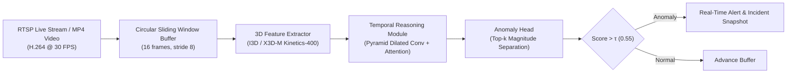
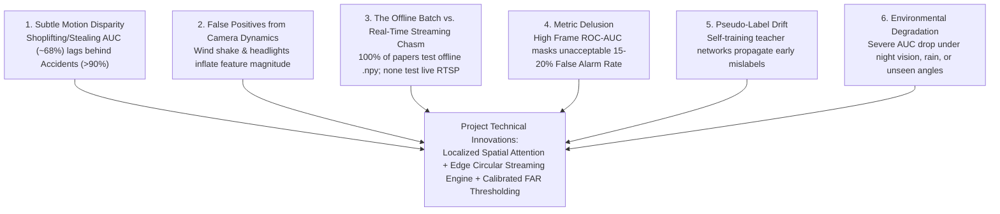

# Real-Time Intelligent Video Surveillance & Anomaly Detection

[](https://www.python.org/)
[](https://pytorch.org/)
[](https://www.crcv.ucf.edu/research/projects-completed-insert/real-world-anomaly-detection-in-surveillance-videos/)
[](LICENSE)
[](https://github.com/areenthomas/Real-Time-Intelligent-Video-Surveillance-and-Anomaly-Detection)

A high-performance research framework and real-time edge inference engine for **Video Anomaly Detection (VAD)** in CCTV surveillance feeds, benchmarked against the **UCF-Crime** dataset.

---

## 📌 Executive Summary

Closed-Circuit Television (CCTV) cameras generate thousands of hours of video per day, making human monitoring inefficient, error-prone, and unsustainable. This project tackles the challenge of **Weakly-Supervised Video Anomaly Detection (WSVAD)** and **Low-Latency Streaming Anomaly Localization**.

Rather than relying on unrealistic fully supervised frame-by-frame timestamps, the system utilizes **Multiple Instance Learning (MIL)** and **Robust Temporal Feature Magnitude (RTFM)** to isolate criminal, hazardous, and emergency events using only video-level annotations.



---

## 🧭 Documentation Map & Topic Guides

Comprehensive documentation has been authored across all submodules of the major project:

| Documentation Guide | Primary Topic |
| :--- | :--- |
| 📚 **[`RESEARCH_PAPERS.md`](RESEARCH_PAPERS.md)** | **Master Literature Compendium:** Detailed survey of 20 verified papers (CVPR, ICCV, ECCV, AAAI) from 2015 to 2025. |
| 🔬 **[`references/research_papers_and_gap_analysis.md`](references/research_papers_and_gap_analysis.md)** | **Deep Gap Analysis:** Granular pairwise failure modes between consecutive historical models. |
| 🧪 **[`TEST_CASES.md`](TEST_CASES.md)** | **Master Test Specification:** Exhaustive matrix across 6 testing dimensions and all 13 UCF-Crime categories. |
| 🧪 **[`tests/README.md`](tests/README.md)** | **Test Execution Guide:** Pytest test harness, fixtures, coverage reports, and stress testing. |
| 📊 **[`data/README.md`](data/README.md)** | **Data Pipeline Guide:** UCF-Crime stats, 32-segment sampling math, feature caching, and loader pipelines. |
| 🧠 **[`models/README.md`](models/README.md)** | **Neural Architecture Guide:** 3D backbones (I3D, X3D-M, C3D), MIL ranking heads, and loss functions. |
| ⚡ **[`streaming/README.md`](streaming/README.md)** | **Real-Time Streaming Guide:** RTSP capture, sliding window buffers, latency budget ($\le 120\text{ ms}$), and alerts. |
| 📈 **[`evaluation/README.md`](evaluation/README.md)** | **Evaluation Metrics Guide:** Frame ROC-AUC, PR-AUC, False Alarm Rate (FAR), and temporal IoU. |
| ⚙️ **[`configs/README.md`](configs/README.md)** | **Configuration Guide:** Dataset, model, and streaming pipeline YAML specifications. |
| 📓 **[`notebooks/README.md`](notebooks/README.md)** | **Jupyter EDA Guide:** Exploratory data analysis, t-SNE manifolds, and score curve overlays. |

---

## 🏆 State-of-the-Art Benchmark on UCF-Crime

| Model / Methodology | Conference & Year | Backbone | Frame ROC-AUC (%) | Primary Methodological Innovation |
| :--- | :--- | :--- | :--- | :--- |
| **Sultani Baseline** | CVPR 2018 | C3D (4096-d) | **75.41%** | 32-Bag MIL Ranking Loss with smoothness & sparsity |
| **Zhong et al.** | CVPR 2019 | C3D / TSN | **82.12%** | Graph Convolutional Network (GCN) label noise cleaner |
| **Motion-Aware (Zhu et al.)** | ICCV 2019 | ResNet-50 | **79.00%** | Decoupled appearance and optical flow dynamics |
| **CLAWS (Zaheer et al.)** | ECCV 2020 | C3D | **83.03%** | Clustering-assisted learning & normalcy suppression |
| **MIST (Feng et al.)** | CVPR 2021 | I3D (2048-d) | **82.30%** | Multiple Instance Self-Training & attention encoder |
| **RTFM (Tian et al.)** | ICCV 2021 | I3D (2048-d) | **84.30%** | Robust Temporal Feature Magnitude learning |
| **S3R (Wu et al.)** | ECCV 2022 | I3D (2048-d) | **80.26%** | Self-Supervised Sparse Representation dictionary |
| **DLAN-AC (Yang et al.)** | ECCV 2022 | I3D (2048-d) | **83.62%** | Dynamic Local Aggregation Network with adaptive clusterer |
| **UMIL (Chen et al.)** | CVPR 2023 | I3D (2048-d) | **85.12%** | Unbiased context de-confounding for MIL |
| **UR-DMU (Zhou et al.)** | AAAI 2023 | I3D (2048-d) | **86.97%** | Dual Memory Units with uncertainty regulation |
| **VadCLIP (Wu et al.)** | AAAI 2024 | CLIP ViT-B/16 | **88.02%** | Vision-Language zero-shot prompt adaptation |

---

## 🔬 The 6 Critical Research Gaps Identified



---

## 📁 Repository Directory Structure

```text
Real-Time-Intelligent-Video-Surveillance-and-Anomaly-Detection/
├── .agents/skills/                    # Complete AI/ML scientific research skills
├── configs/                           # Centralized YAML configuration files
│   ├── dataset_ucf_crime.yaml         # Dataset paths, class mappings & bag settings
│   ├── model_rtfm_i3d.yaml            # Backbone, loss weights & training parameters
│   ├── streaming_pipeline.yaml        # RTSP stream URL, buffer size & alert thresholds
│   └── README.md                      # Configs documentation
├── data/                              # Dataset loaders, feature caches & documentation
│   ├── dataset_documentation.md       # 128-hr audit, 13 crime classes & ground-truth formats
│   └── README.md                      # Data pipeline guide & 32-segment sampling math
├── models/                            # Modular deep learning components
│   ├── backbones/                     # I3D / C3D / X3D-M feature extractors
│   ├── heads/                         # MIL ranking & RTFM temporal magnitude heads
│   ├── losses/                        # Hinge ranking loss, sparsity & smoothness
│   └── README.md                      # Models documentation & mathematical formulations
├── streaming/                         # Asynchronous RTSP ingestion & circular sliding buffer
│   └── README.md                      # Real-time streaming & latency budget guide
├── evaluation/                        # Frame-level ROC-AUC, PR-AUC, and False Alarm Rate (FAR)
│   └── README.md                      # Evaluation metrics & benchmark runbook
├── tests/                             # 6-dimension automated test suite
│   └── README.md                      # Test suite documentation & pytest commands
├── notebooks/                         # Exploratory data analysis & feature visualization
│   └── README.md                      # Notebooks overview & execution guide
├── references/                        # Academic literature & BibTeX catalog
│   ├── references.bib                 # Audited BibTeX entries
│   └── research_papers_and_gap_analysis.md # Detailed pairwise gap analysis
├── RESEARCH_PAPERS.md                 # Master 20-paper literature compendium
├── TEST_CASES.md                      # Master 6-dimension test specification matrix
├── push_to_github.bat                 # 1-click Windows Git push automation
├── push_to_github.ps1                 # PowerShell Git push automation
├── requirements.txt                   # Python dependency specifications
├── LICENSE                            # MIT License
└── README.md                          # Project master documentation
```

---

## 📖 Citation

```bibtex
@inproceedings{sultani2018real,
  author    = {Sultani, Waqas and Chen, Chen and Shah, Mubarak},
  title     = {Real-World Anomaly Detection in Surveillance Videos},
  booktitle = {Proceedings of the IEEE Conference on Computer Vision and Pattern Recognition (CVPR)},
  year      = {2018}
}

@inproceedings{tian2021weakly,
  author    = {Tian, Yu and Pang, Guansong and Chen, Yuanhong and Singh, Rajvinder and Verjans, Johan W. and Carneiro, Gustavo},
  title     = {Weakly-Supervised Video Anomaly Detection With Robust Temporal Feature Magnitude Learning},
  booktitle = {Proceedings of the IEEE/CVF International Conference on Computer Vision (ICCV)},
  year      = {2021}
}
```
