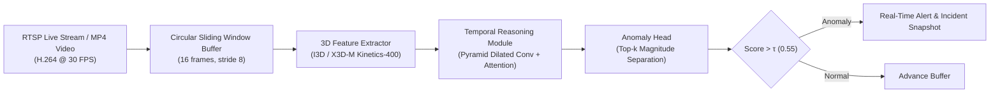
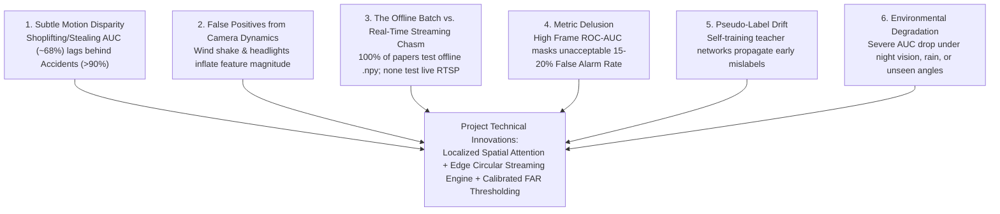

# Real-Time Intelligent Video Surveillance & Anomaly Detection

[](https://www.python.org/)
[](https://pytorch.org/)
[](https://www.crcv.ucf.edu/research/projects-completed-insert/real-world-anomaly-detection-in-surveillance-videos/)
[](LICENSE)
[](https://github.com/areenthomas/Real-Time-Intelligent-Video-Surveillance-and-Anomaly-Detection)

A high-performance research framework and real-time edge inference engine for **Video Anomaly Detection (VAD)** in CCTV surveillance feeds, benchmarked against the **UCF-Crime** dataset.

---

## 📌 Executive Summary

Closed-Circuit Television (CCTV) cameras generate thousands of hours of video per day, making human monitoring inefficient, error-prone, and unsustainable. This project tackles the challenge of **Weakly-Supervised Video Anomaly Detection (WSVAD)** and **Low-Latency Streaming Anomaly Localization**.

Rather than relying on unrealistic fully supervised frame-by-frame timestamps, the system utilizes **Multiple Instance Learning (MIL)** and **Robust Temporal Feature Magnitude (RTFM)** to isolate criminal, hazardous, and emergency events using only video-level annotations.



---

## 🏆 State-of-the-Art Benchmark on UCF-Crime

The table below summarizes verified published benchmarks on the **UCF-Crime** dataset across top-tier computer vision conferences:

| Model / Methodology | Conference & Year | Backbone | Frame ROC-AUC (%) | Key Innovation |
| :--- | :--- | :--- | :--- | :--- |
| **Sultani Baseline** | CVPR 2018 | C3D (4096-d) | **75.41%** | 32-Bag MIL Ranking Loss with smoothness & sparsity |
| **Zhong et al.** | CVPR 2019 | C3D / TSN | **82.12%** | Graph Convolutional Network (GCN) label noise cleaner |
| **Motion-Aware (Zhu et al.)** | ICCV 2019 | ResNet-50 | **79.00%** | Decoupled appearance and optical flow dynamics |
| **S3R (Wu et al.)** | ECCV 2022 | I3D (2048-d) | **80.26%** | Self-Supervised Sparse Representation dictionary |
| **MIST (Feng et al.)** | CVPR 2021 | I3D (2048-d) | **82.30%** | Multiple Instance Self-Training & attention encoder |
| **RTFM (Tian et al.)** | ICCV 2021 | I3D (2048-d) | **84.30%** | Robust Temporal Feature Magnitude learning |
| **UMIL (Chen et al.)** | CVPR 2023 | I3D (2048-d) | **85.12%** | Unbiased context de-confounding for MIL |
| **UR-DMU (Zhou et al.)** | AAAI 2023 | I3D (2048-d) | **86.97%** | Dual Memory Units with uncertainty regulation |
| **VadCLIP (Wu et al.)** | AAAI 2024 | CLIP ViT-B/16 | **88.02%** | Vision-Language zero-shot prompt adaptation |

---

## 🔬 The 6 Critical Research Gaps Identified

A thorough audit of existing literature reveals 6 primary unresolved research gaps that this major project addresses:



Detailed paper-by-paper analyses and mathematical formulations are documented in [`references/research_papers_and_gap_analysis.md`](references/research_papers_and_gap_analysis.md).

---

## 📊 UCF-Crime Dataset Specification

The project is benchmarked on the 128-hour, 1,900-video **UCF-Crime** dataset:
- **Training Set (Weak Supervision):** 1,610 untrimmed videos (810 abnormal + 800 normal) labeled *only* at the video level (no temporal timestamps).
- **Testing Set (Frame-Level Ground Truth):** 290 videos (140 abnormal + 150 normal) with frame-by-frame temporal bounding intervals.
- **13 Anomaly Categories:** Abuse, Arrest, Arson, Assault, Burglary, Explosion, Fighting, Road Accidents, Robbery, Shooting, Shoplifting, Stealing, Vandalism, and Normal.

Detailed dataset breakdown, split protocols, and download guidelines are documented in [`data/dataset_documentation.md`](data/dataset_documentation.md).

---

## 📁 Repository Directory Structure

```text
Real-Time-Intelligent-Video-Surveillance-and-Anomaly-Detection/
├── .agents/skills/            # Research & scientific writing agent skills
├── configs/                   # Centralized YAML configuration files
│   ├── dataset_ucf_crime.yaml # Dataset paths, class mappings & bag settings
│   ├── model_rtfm_i3d.yaml    # Backbone, loss weights & training parameters
│   └── streaming_pipeline.yaml# RTSP stream URL, buffer size & alert thresholds
├── data/                      # Dataset loaders, feature caches & documentation
│   └── dataset_documentation.md
├── models/                    # Modular deep learning components
│   ├── backbones/             # I3D / C3D / X3D-M feature extractors
│   ├── heads/                 # MIL ranking & RTFM temporal magnitude heads
│   └── losses/                # Hinge ranking loss, sparsity & smoothness
├── streaming/                 # Asynchronous RTSP ingestion & circular sliding buffer
├── evaluation/                # Frame-level ROC-AUC, PR-AUC, and False Alarm Rate (FAR)
├── tests/                     # 6-dimension automated test suite
├── notebooks/                 # Exploratory data analysis & feature visualization
├── references/                # State-of-the-art compendium & BibTeX catalog
│   ├── references.bib         # Audited BibTeX entries
│   └── research_papers_and_gap_analysis.md
├── push_to_github.bat         # 1-click Windows Git push automation
├── push_to_github.ps1         # PowerShell Git push automation
├── requirements.txt           # Python dependency specifications
└── README.md                  # Project master documentation
```

---

## 🧪 Comprehensive Test Suite (6 Dimensions)

The repository integrates a rigorous test specification:
1. **Data Pipeline Tests (`TC-DATA`):** Verifies 32-bag partitioners, tensor shapes `(B, 32, 2048)`, and frame mask alignment.
2. **Model Architecture Tests (`TC-MOD`):** Tests score bounds $[0, 1]$, ranking loss symmetry, and numerical gradient stability.
3. **Crime Category Tests (`TC-CRIME`):** Dedicated functional validation across all 13 crime classes + normal CCTV footage.
4. **Real-Time Streaming Tests (`TC-RT`):** Benchmarks inference throughput ($\ge 25\text{ FPS}$), latency budget ($\le 120\text{ ms}$), and 24-hour VRAM stability.
5. **Stress & Environmental Tests (`TC-STRESS`):** Evaluates resilience against camera jitter, night vision sensor grain, sudden illumination shifts, and dense pedestrian crowds.
6. **Metric Evaluation Tests (`TC-METRIC`):** Validates frame-level ROC-AUC, PR-AUC, and False Alarm Rate (FAR) formulas against known synthetic ground truth.

---

## 🚀 Pushing to GitHub

To connect and push this repository to [`areenthomas/Real-Time-Intelligent-Video-Surveillance-and-Anomaly-Detection`](https://github.com/areenthomas/Real-Time-Intelligent-Video-Surveillance-and-Anomaly-Detection):

### Option A: 1-Click Automated Push (Recommended)
Double-click `push_to_github.bat` or run:
```powershell
.\push_to_github.ps1
```

### Option B: Manual Git Commands
```bash
# Initialize and link repository
git init
git remote add origin https://github.com/areenthomas/Real-Time-Intelligent-Video-Surveillance-and-Anomaly-Detection.git

# Stage and commit
git add .
git commit -m "feat: complete research compendium, literature matrix, gap analysis, and UCF-Crime test framework"

# Push to main branch
git branch -M main
git push -u origin main
```

---

## 📖 Citation

If using this research framework or repository, please cite the primary literature:

```bibtex
@inproceedings{sultani2018real,
  author    = {Sultani, Waqas and Chen, Chen and Shah, Mubarak},
  title     = {Real-World Anomaly Detection in Surveillance Videos},
  booktitle = {Proceedings of the IEEE Conference on Computer Vision and Pattern Recognition (CVPR)},
  year      = {2018}
}

@inproceedings{tian2021weakly,
  author    = {Tian, Yu and Pang, Guansong and Chen, Yuanhong and Singh, Rajvinder and Verjans, Johan W. and Carneiro, Gustavo},
  title     = {Weakly-Supervised Video Anomaly Detection With Robust Temporal Feature Magnitude Learning},
  booktitle = {Proceedings of the IEEE/CVF International Conference on Computer Vision (ICCV)},
  year      = {2021}
}
```
