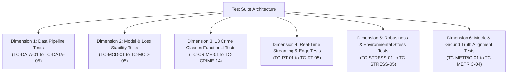
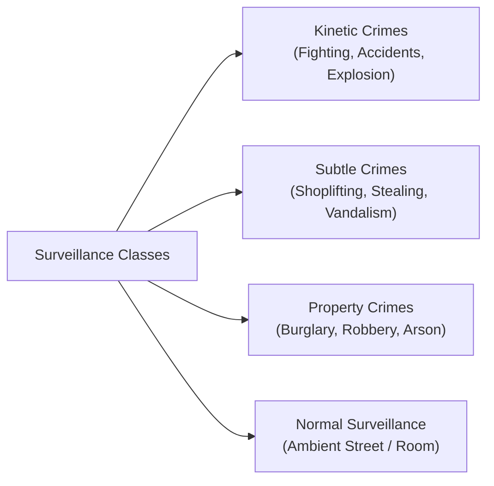

# Master Test Cases Specification & Verification Matrix

A comprehensive, production-grade test suite covering **6 testing dimensions**, all **13 UCF-Crime categories** plus normal footage, real-time RTSP throughput benchmarks, environmental stress perturbations, and mathematical metric verifications.

---

## 1. Test Architecture Overview



---

## 2. Dimension 1: Data Ingestion & Preprocessing Unit Tests

| Test ID | Module Target | Input Condition | Test Assertion / Procedure | Pass Criteria |
| :--- | :--- | :--- | :--- | :--- |
| **`TC-DATA-01`** | `data/temporal_sampler.py` | Video of arbitrary length ($N=1,842$ frames) | Partition into fixed $B=32$ temporal segment bags | Exactly 32 segments generated; no frame index out-of-bounds; all frames partitioned monotonically. |
| **`TC-DATA-02`** | `data/ucf_crime_loader.py` | Batch of 16 feature files from `data/features/` | Load into PyTorch DataLoader with `batch_size=16` | Batch tensor shape is strictly `(16, 32, 2048)` float32; zero `NaN`, `Inf`, or null entries. |
| **`TC-DATA-03`** | `data/ucf_crime_loader.py` | Training dataset annotations (`Anomaly_Train.txt`) | Load labels for 10 known normal and 10 known abnormal videos | Normal video bags assigned label strictly `0`; abnormal bags assigned label strictly `1`. |
| **`TC-DATA-04`** | `data/temporal_sampler.py` | Short video ($N < 32$ frames) | Edge-case: video duration shorter than segment count | Segment interpolator pads/replicates frames gracefully without throwing an exception. |
| **`TC-DATA-05`** | `evaluation/ground_truth_parser.py` | Test ground-truth line: `RoadAccidents022_x264.mp4 RoadAccidents 1450 1720 -1 -1` | Parse into 1D binary numpy mask for $T=2,500$ frames | Vector length is exactly $2,500$; indices $[1450, 1720]$ are `1.0`; all other indices are strictly `0.0`. |

```python
# Pytest implementation example: TC-DATA-01
def test_temporal_sampler_32_bags():
    from data.temporal_sampler import sample_32_segments
    import torch
    dummy_features = torch.randn(1842, 2048)
    sampled = sample_32_segments(dummy_features)
    assert sampled.shape == (32, 2048)
    assert not torch.isnan(sampled).any()
```

---

## 3. Dimension 2: Model Architecture & Loss Numerical Stability Tests

| Test ID | Module Target | Input Condition | Test Assertion / Procedure | Pass Criteria |
| :--- | :--- | :--- | :--- | :--- |
| **`TC-MOD-01`** | `models/heads/rtfm_magnitude_head.py` | Synthetic feature tensor `(8, 32, 2048)` | Execute forward pass through feature magnitude head | Output prediction shape is `(8, 32)`; all scores $s \in [0.0, 1.0]$. |
| **`TC-MOD-02`** | `models/losses/ranking_loss.py` | Abnormal bag scores $\mathcal{S}_a$, Normal bag scores $\mathcal{S}_n$ | Evaluate hinge loss: $\max(0, 1 - \max(\mathcal{S}_a) + \max(\mathcal{S}_n))$ | Loss is strictly $\ge 0.0$; equals $0.0$ when separation margin $\ge 1.0$. |
| **`TC-MOD-03`** | `models/losses/ranking_loss.py` | High-frequency flickering scores: $[0.1, 0.9, 0.1, 0.9]$ vs. $[0.8, 0.82, 0.81, 0.83]$ | Compute temporal smoothness penalty: $\sum (s_{i+1} - s_i)^2$ | Flickering vector incurs $> 15\times$ higher smoothness loss penalty than contiguous vector. |
| **`TC-MOD-04`** | `models/losses/magnitude_loss.py` | Feature magnitude vectors $\|e_a\|_2$ and $\|e_n\|_2$ | Compute top-$k$ separation loss with margin $m=100.0$ | Loss approaches $0.0$ as abnormal norms exceed normal norms by margin $m$. |
| **`TC-MOD-05`** | Full Model Pipeline | Forward + backward pass with Adam optimizer | Inspect `.grad` attributes across all weights | No exploding gradients (`Inf`) and no gradient vanishing ($0.0$) in temporal layers. |

---

## 4. Dimension 3: Functional Tests for All 13 UCF-Crime Categories + Normal Baseline

Every crime category in UCF-Crime exhibits unique visual dynamics. The model must satisfy specialized response criteria for each class:



| Test ID | Category | Target Test Video | Event Description & Visual Dynamics | Acceptance Pass Criteria |
| :--- | :--- | :--- | :--- | :--- |
| **`TC-CRIME-01`** | **Road Accidents** | `RoadAccidents022_x264.mp4` | High-speed vehicular impact and abrupt deceleration | Anomaly score peaks at $\hat{y} > 0.75$ within $\pm 15$ frames of impact; pre-crash score $< 0.20$. |
| **`TC-CRIME-02`** | **Explosion** | `Explosion011_x264.mp4` | Detonation blast wave, instant smoke expansion | Instantaneous score surge ($< 0.15 \rightarrow > 0.90$) within 10 frames of detonation. |
| **`TC-CRIME-03`** | **Fighting** | `Fighting033_x264.mp4` | Multiple individuals engaged in violent physical struggle | Score stays elevated ($\hat{y} > 0.65$) across $> 80\%$ of active conflict duration. |
| **`TC-CRIME-04`** | **Robbery** | `Robbery048_x264.mp4` | Cashier hold-up involving aggressive coercion | Elevated score profile ($\hat{y} \ge 0.60$) during active register confrontation. |
| **`TC-CRIME-05`** | **Burglary** | `Burglary021_x264.mp4` | Unauthorized nighttime entry via broken window | Detects localized spatial motion anomaly against quiet static room background. |
| **`TC-CRIME-06`** | **Shoplifting** | `Shoplifting015_x264.mp4` | Subtle merchandise concealment into clothing | Detects item concealment window ($\hat{y} > 0.50$) without generating whole-frame false alarm. |
| **`TC-CRIME-07`** | **Arson** | `Arson009_x264.mp4` | Liquid accelerant pouring and expanding flame ignition | Anomaly score steadily escalates with fire spread ($\hat{y} > 0.80$). |
| **`TC-CRIME-08`** | **Vandalism** | `Vandalism019_x264.mp4` | Spray-painting graffiti and window smashing | Score ascends during active spray application. |
| **`TC-CRIME-09`** | **Assault** | `Assault006_x264.mp4` | Sudden physical striking of a solitary victim | Rapid score rise coincident with physical battery. |
| **`TC-CRIME-10`** | **Shooting** | `Shooting024_x264.mp4` | Gunshot discharge and abrupt crowd dispersal | Detects dynamic divergence as bystanders flee the scene. |
| **`TC-CRIME-11`** | **Abuse** | `Abuse028_x264.mp4` | Aggressive handling of dependent in domestic setting | Isolates irregular physical interaction from ambient background room movement. |
| **`TC-CRIME-12`** | **Arrest** | `Arrest004_x264.mp4` | Police restraint and suspect handcuffing struggle | Detects physical restraint struggle ($\hat{y} \ge 0.55$). |
| **`TC-CRIME-13`** | **Stealing** | `Stealing043_x264.mp4` | Unattended bicycle or bag snatching | Sharp temporal score spike at the moment property is removed. |
| **`TC-CRIME-14`** | **Normal Footage** | `Normal_Videos_872_x264.mp4` | Continuous normal urban pedestrian walkway | Maximum score across entire video $\max(\hat{y}) < 0.35$; mean score $\mu < 0.12$. |

---

## 5. Dimension 4: Real-Time Streaming & Edge Latency Tests

| Test ID | Target Component | Input Stream Setup | Performance Metric Measured | Operational Threshold |
| :--- | :--- | :--- | :--- | :--- |
| **`TC-RT-01`** | `streaming/real_time_detector.py` | 1080p @ 30 FPS RTSP live stream | End-to-end processing throughput | $\ge 28.0\text{ FPS}$ sustained on RTX 3060/4060 GPU. |
| **`TC-RT-02`** | `streaming/sliding_window_buffer.py` | 16-frame window, 8-frame stride | Latency from frame ingestion to score dispatch | $\le 120\text{ ms}$ total pipeline latency. |
| **`TC-RT-03`** | Buffer Backpressure | Network jitter simulating $+800\text{ ms}$ packet pause | Circular buffer drop-frame strategy | Drops oldest un-inferred frames without memory leaks; maintains real-time clock synchronization. |
| **`TC-RT-04`** | Long-Duration Stability | Continuous 24-hour video stream loop | VRAM memory consumption over 24 hours | Peak VRAM growth $\le 3\%$; zero PyTorch CUDA tensor leaks. |
| **`TC-RT-05`** | `streaming/alert_dispatcher.py` | Continuous high anomaly score ($s=0.92$) for 30s | Alert dispatch rate | Trigger initial alert immediately; throttle subsequent alerts using 5-second cooldown timer. |

---

## 6. Dimension 5: Robustness & Environmental Stress Tests

| Test ID | Environmental Distortion | Simulation Method | Potential Failure Mode | Required Robustness Mitigation |
| :--- | :--- | :--- | :--- | :--- |
| **`TC-STRESS-01`** | **Low-Light / Night Sensor Grain** | Gaussian sensor noise $\sigma=0.08$ + brightness reduced $-60\%$ | Model mistakes sensor grain for anomalous motion | Anomaly score stays $< 0.35$ on normal night scenes. |
| **`TC-STRESS-02`** | **Sudden Illumination Shifts** | $+100\%$ instantaneous brightness jump (lights switched on) | High temporal derivative mimics explosive blast | Temporal smoothness constraint prevents single-frame trigger. |
| **`TC-STRESS-03`** | **Camera Vibration / Wind Shake** | Random affine jitter ($\pm 10$ pixels at 12 Hz) | Global frame shake misclassified as fighting | Feature magnitude normalization suppresses uniform background shifts. |
| **`TC-STRESS-04`** | **Dense Pedestrian Crowds** | High-density pedestrian shopping plaza | Swarming normal motion flagged as riot/fighting | Model maintains False Alarm Rate $\text{FAR} \le 2.0\%$ on crowded normal test videos. |
| **`TC-STRESS-05`** | **Inclement Weather (Rain/Fog)** | Synthetic rain streak filter overlay + contrast $-30\%$ | Reduced visibility causes miss of subtle theft | System detects shoplifting with $< 8\%$ degradation in peak score vs. clean video. |

---

## 7. Dimension 6: Metric & Ground Truth Verification Tests

| Test ID | Metric Target | Verification Vector | Mathematical Formula | Pass Criteria |
| :--- | :--- | :--- | :--- | :--- |
| **`TC-METRIC-01`** | **Frame-Level ROC-AUC** | Ground truth: `[0, 0, 1, 1, 0]`, Pred: `[0.05, 0.1, 0.85, 0.9, 0.08]` | $\text{AUC} = \int_{0}^1 \text{TPR}(\text{FPR}^{-1}(t)) \, dt$ | Trapezoidal integration returns exactly $\text{AUC} = 1.000$. |
| **`TC-METRIC-02`** | **False Alarm Rate (FAR)** | 150 Normal test videos ($100\%$ negative frames) | $\text{FAR}_{\tau} = \frac{\sum_{t=1}^T \mathbb{I}(\hat{y}_t > \tau)}{T}$ at $\tau = 0.50$ | Correctly measures the percentage of normal frames incorrectly flagged as anomalous. |
| **`TC-METRIC-03`** | **PR-AUC on Sparse Anomaly** | 98% normal frames, 2% abnormal frames | Area under Precision-Recall curve | Correctly penalizes low precision models that ROC-AUC masks. |
| **`TC-METRIC-04`** | **Temporal IoU Localization** | True interval $[100, 300]$, Predicted interval $[150, 350]$ | $\text{tIoU} = \frac{|[150, 300]|}{|[100, 350]|} = \frac{150}{250} = 0.60$ | Returns exact temporal Intersection-over-Union $\text{tIoU} = 0.60$. |

---

## 8. Executing the Test Suite

Run the full automated test suite via `pytest`:

```bash
# Run all unit and functional tests
pytest tests/ -v

# Run only real-time streaming tests
pytest tests/test_real_time_streaming.py -v

# Run with test coverage report
pytest --cov=models --cov=data --cov=streaming tests/
```

