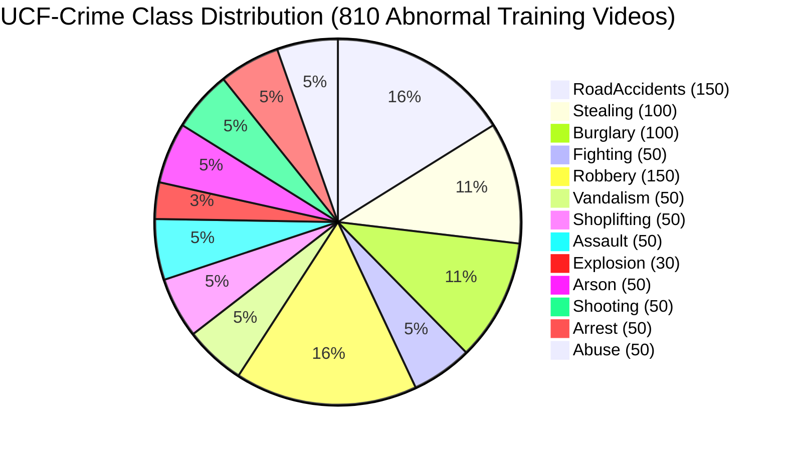
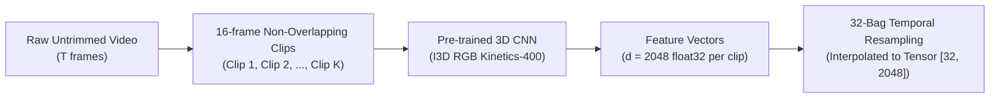

# UCF-Crime Dataset: Architecture, Annotations & Benchmark Protocol

---

## 1. Dataset Overview

The **UCF-Crime** dataset is the primary large-scale benchmark for real-world video anomaly detection in surveillance video feeds. It was collected from actual closed-circuit television (CCTV) cameras capturing genuine criminal, hazardous, and emergency situations in urban environments.

- **Creators:** Waqas Sultani, Chen Chen, and Mubarak Shah (Center for Research in Computer Vision, University of Central Florida).
- **Conference Debut:** IEEE/CVF CVPR 2018.
- **Scale:** **1,900 untrimmed surveillance videos**, totaling **128 hours** of video footage.
- **Resolution:** Variable real-world surveillance resolutions (predominantly 320x240 and 640x480) recorded at 30 frames per second.
- **Quality Characteristics:** Captures real-world noise: low illumination, optical distortion, compression artifacts, severe motion blur, camera vibration, and varying weather conditions.

---

## 2. The 13 Anomaly Classes & Class Balance



1. **Abuse:** Physical domestic or caregiver violence.
2. **Arrest:** Law enforcement restraint and handcuffing of non-compliant suspects.
3. **Arson:** Intentional ignition of fires and rapid flame spreading.
4. **Assault:** Physical altercations involving strikes and bodily harm.
5. **Burglary:** Illegal unauthorized entry into commercial or residential premises.
6. **Explosion:** Sudden detonations, high-velocity smoke/fire plumes, and shockwaves.
7. **Fighting:** Violent mutual combat between multiple individuals.
8. **RoadAccidents:** Motor vehicle collisions, rollovers, and pedestrian vehicle strikes.
9. **Robbery:** Armed theft utilizing physical coercion or deadly weapons.
10. **Shooting:** Discharge of firearms, visible gunshots, and rapid crowd dispersion.
11. **Shoplifting:** Concealment of store merchandise into clothing/bags.
12. **Stealing:** Bag snatching, bicycle theft, and property removal.
13. **Vandalism:** Property destruction, window smashing, and graffiti application.
14. **Normal:** Routine daily surveillance without any criminal activity.

---

## 3. Train / Test Split Architecture & Annotation Schemas

### Training Partition (Weak Video-Level Supervision)
- **Total Videos:** 1,610 videos (810 anomalous + 800 normal).
- **Supervision Rule:** Video-level binary label $Y \in \{0, 1\}$.
  - $Y=0$: Video contains strictly normal activity throughout its entire duration.
  - $Y=1$: Video contains an anomalous event at some unknown time window.
- **No Temporal Timestamps Provided:** The training protocol enforces Multiple Instance Learning (MIL); models must infer which segments contain the anomaly without frame-level supervision.

### Testing Partition (Frame-Level Temporal Ground Truth)
- **Total Videos:** 290 videos (140 anomalous + 150 normal).
- **Supervision Rule:** Frame-level binary ground-truth vector $\mathbf{y} \in \{0, 1\}^T$ where $T$ is the total frame count.
- **Annotation Format (`Temporal_Anomaly_Annotation_for_Testing_Videos.txt`):**
  Each line specifies the video name, anomaly class, and the exact starting and ending frame numbers for anomalous events:
  ```text
  RoadAccidents022_x264.mp4  RoadAccidents  1450  1720  -1  -1
  Fighting033_x264.mp4       Fighting       350   720   1100  1450
  Normal_Videos_872_x264.mp4 Normal         -1    -1    -1    -1
  ```
  *(Note: Videos with two distinct anomalous events list two `[start, end]` intervals; normal videos list `-1 -1`).*

---

## 4. Feature Extraction & Precomputed Storage Protocols

Because processing 110 GB of raw video during every training epoch is computationally prohibitive, standard research protocol utilizes precomputed 3D CNN features:



### Precomputed Asset Options:
1. **Pre-extracted I3D Features (Recommended):**
   - Size: ~15 GB.
   - Format: NumPy `.npy` or PyTorch `.pt` files.
   - Dimension: 2048-dim float32 vector per 16-frame snippet.
   - Fast loading via memory mapping (`numpy.load(..., mmap_mode='r')`).
2. **Pre-extracted C3D Features (Legacy Baseline):**
   - Size: ~35 GB.
   - Dimension: 4096-dim from the `fc6` layer of C3D.
3. **Raw Video Files (Optional):**
   - Size: ~110 GB.
   - Format: MP4 / H.264.

---

## 5. Download Access & Official Repositories

- **Official CRCV Project Page:** [CRCV UCF-Crime](https://www.crcv.ucf.edu/research/projects-completed-insert/real-world-anomaly-detection-in-surveillance-videos/)
- **Kaggle Mirror (Pre-extracted Features & Videos):** Available under UCF Crime Dataset mirrors on Kaggle.
- **Official GitHub Baseline:** [WaqasSultani/AnomalyDetectionCVPR2018](https://github.com/WaqasSultani/AnomalyDetectionCVPR2018)

